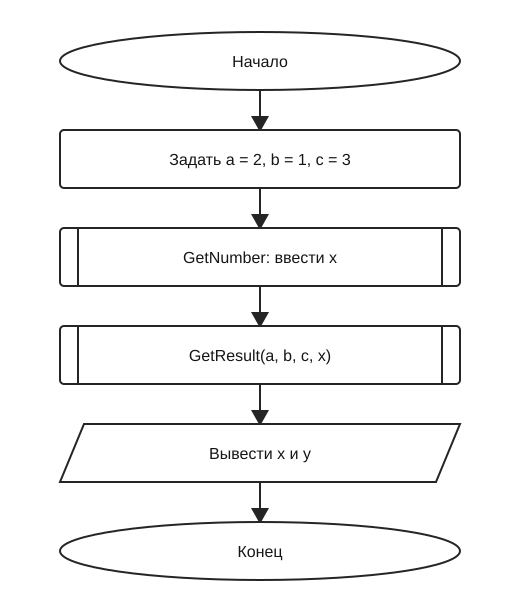
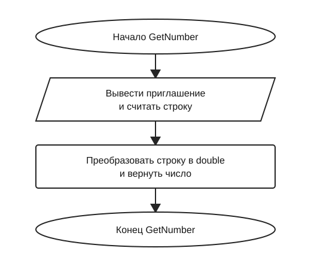
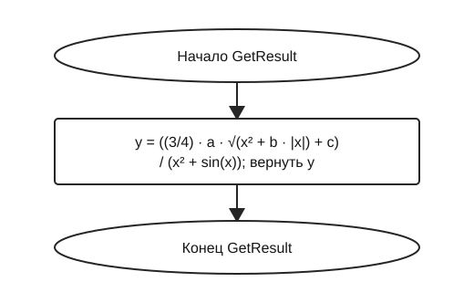

# Отчёт по заданию 1.1, вариант 25

Группа ИБД 621-2.

Вычисляется функция `y = ((3/4) · a · √(x² + b · |x|) + c) / (x² + sin(x))` при `a = 2`, `b = 1`, `c = 3`. Пользователь вводит `x`; программа выводит `x` и `y`. Контрольный пример: при `x = 2` получается `y ≈ 1,3595091178841614`.

В главной схеме вызовы функций обозначены блоками «предопределённый процесс» (прямоугольник с двумя вертикальными линиями). Каждая функция показана отдельно. Все блоки на схемах имеют одинаковую ширину.

## Main

## GetNumber

## GetResult

