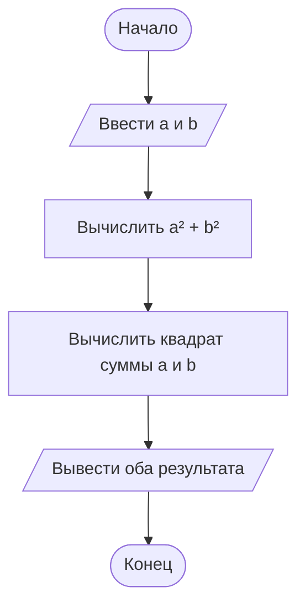

# Отчёт по заданию 1.2, вариант 25

Группа ИБД 621-2.

Для введённых `a` и `b` вычислить два разных выражения: `a² + b²` и `(a + b)²`. Например, при `a = 2`, `b = 3` результаты `13` и `25`. В программе каждое выражение вычисляется отдельной функцией.

