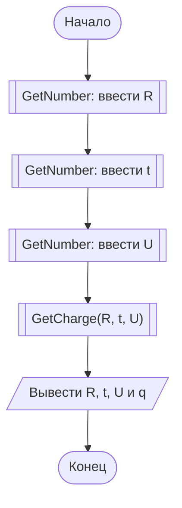
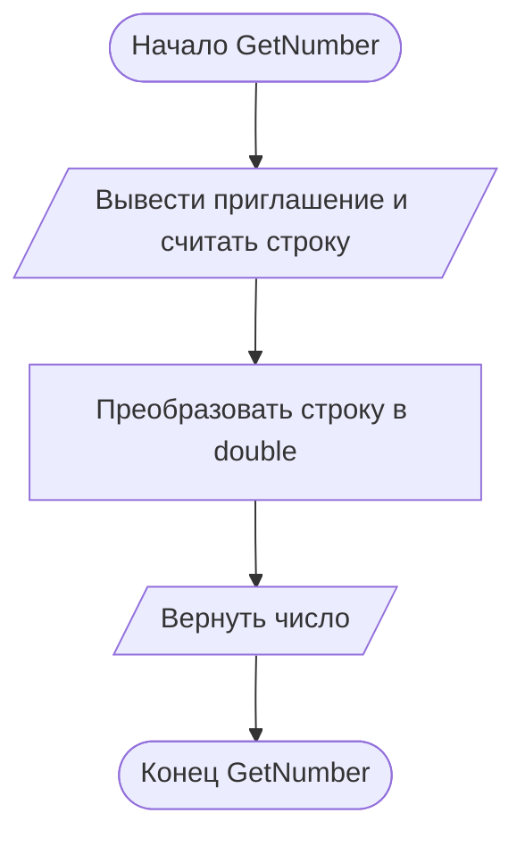
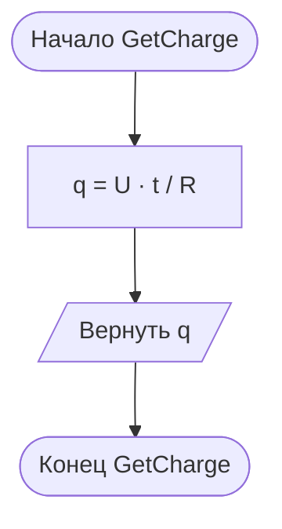

# Отчёт по заданию 1.3, вариант 25

Группа ИБД 621-2.

По закону Ома `I = U / R`, а заряд за время `t` равен `q = I · t = U · t / R`. При `R = 2 Ом`, `t = 3 с`, `U = 4 В` получаем `q = 6 Кл`. Формула определена при `R ≠ 0`. В заданиях 1 вводятся корректные исходные данные.

В главной схеме вызовы функций обозначены блоками «предопределённый процесс» (прямоугольник с двумя вертикальными линиями). Каждая функция показана отдельно.

## Main

## GetNumber

## GetCharge

