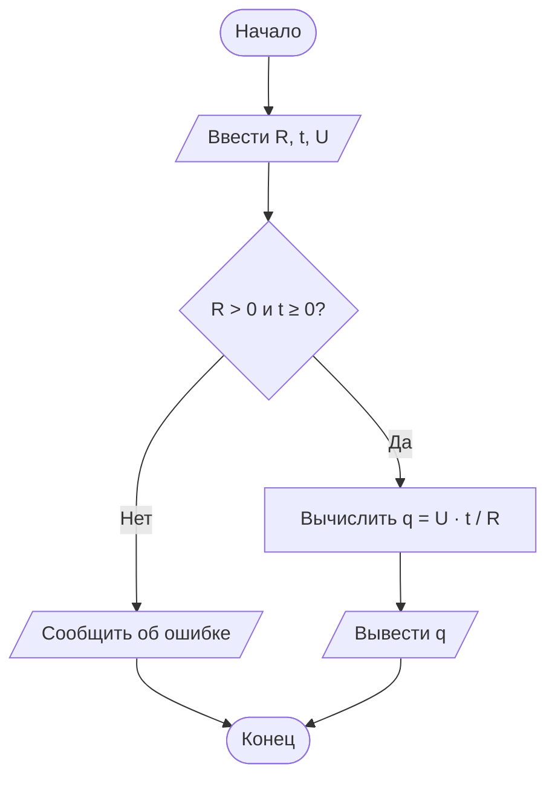

# Отчёт по заданию 1.3, вариант 25

Группа ИБД 621-2.

По закону Ома `I = U / R`, а заряд за время `t` равен `q = I · t = U · t / R`. При `R = 2 Ом`, `t = 3 с`, `U = 4 В` получаем `q = 6 Кл`. Требуется `R > 0` и `t ≥ 0`.

