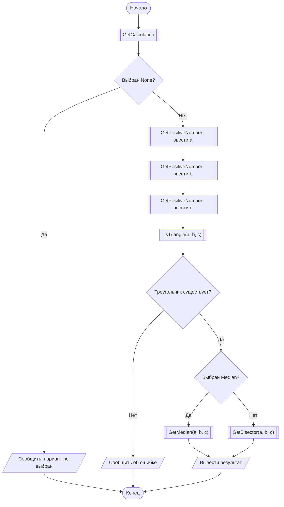
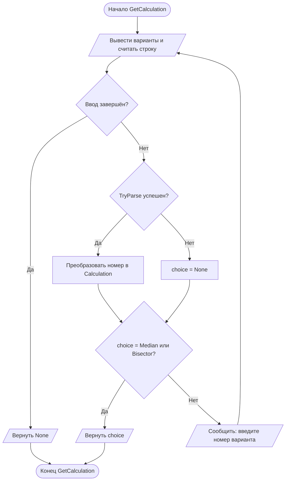
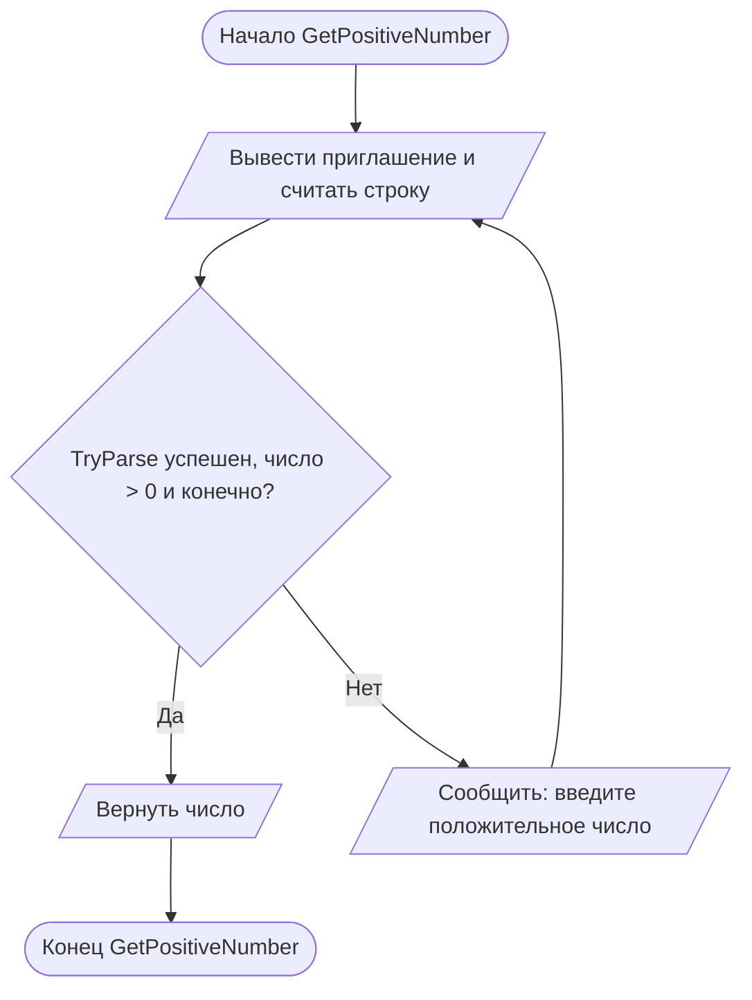
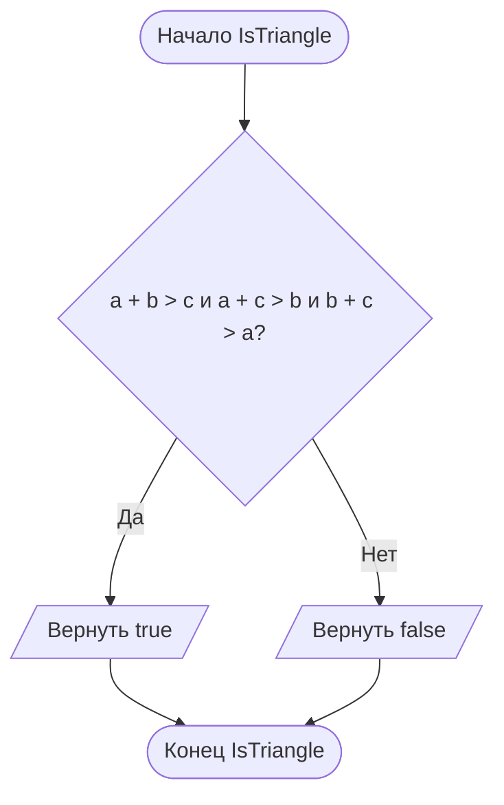
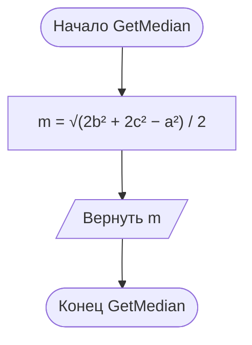
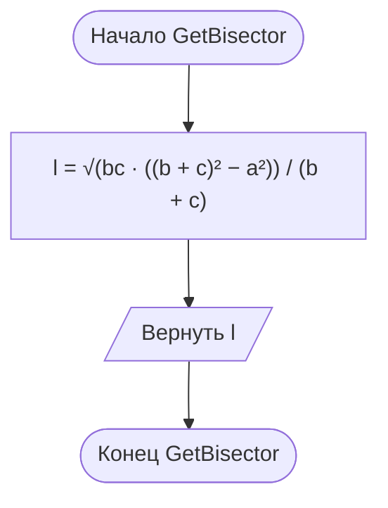

# Отчёт по заданию 2-1, вариант 25

Группа ИБД 621-2.

По трём сторонам треугольника и выбору пользователя вычисляется длина медианы или биссектрисы к стороне `a`. Вариант выбирается с помощью `enum`.

- Медиана: `mₐ = √(2b² + 2c² − a²) / 2`.
- Биссектриса: `lₐ = √(bc · ((b + c)² − a²)) / (b + c)`.

Сначала проверяются положительность сторон и неравенства треугольника. Для сторон `a = 3`, `b = 4`, `c = 5`: медиана `4,272001872658765`, биссектриса `4,216370213557839`. Значение `Calculation.None` означает, что вариант не выбран.

В главной схеме вызовы функций обозначены блоками «предопределённый процесс» (прямоугольник с двумя вертикальными линиями). Каждая функция показана отдельно.

## Main

## GetCalculation

## GetPositiveNumber

## IsTriangle

## GetMedian

## GetBisector

