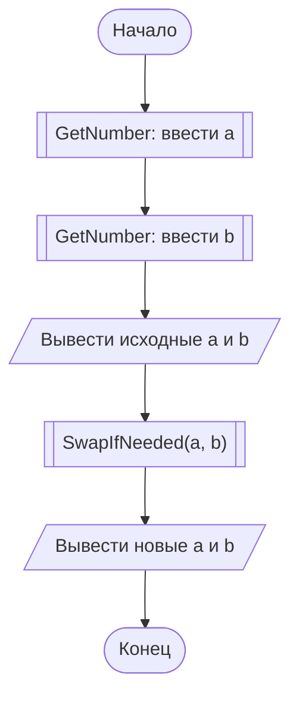
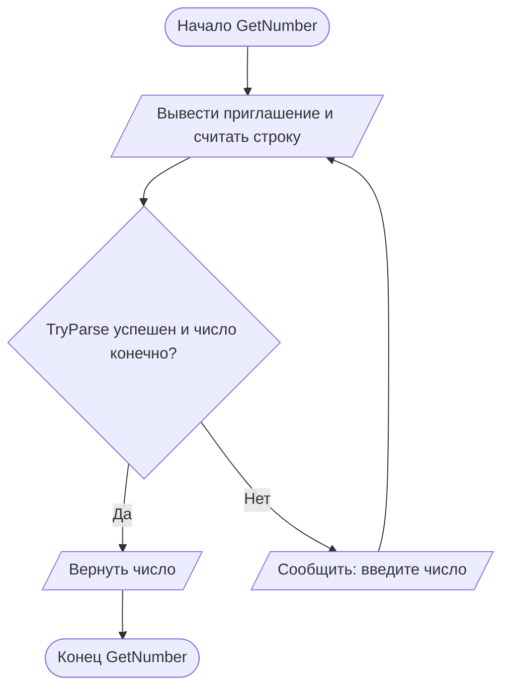
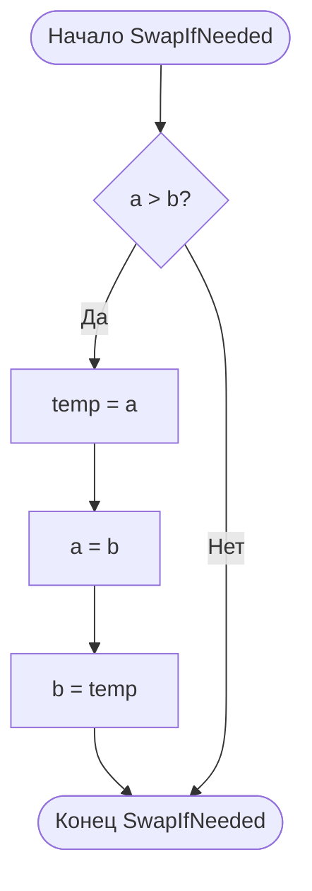

# Отчёт по заданию 2-2, вариант 25

Группа ИБД 621-2.

Если `a > b`, функция `SwapIfNeeded` меняет значения через третью переменную `temp`; иначе значения не меняются. Например, при `a = 9`, `b = 2` результат: `a = 2`, `b = 9`.

В программе три функции, поэтому для каждой приведена отдельная блок-схема. В главной схеме вызовы функций обозначены блоком «предопределённый процесс» (прямоугольник с двумя вертикальными линиями).

## Main

## GetNumber

## SwapIfNeeded

