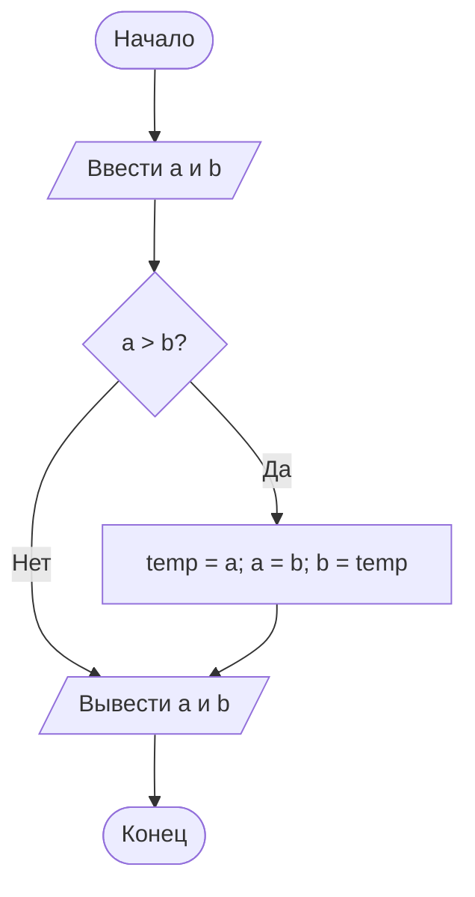

# Отчёт по заданию 2-2, вариант 25

Группа ИБД 621-2.

Если `a > b`, обменять значения через третью переменную `temp`; иначе сохранить их. Ввод проверяется с помощью `double.TryParse`. Например, из `a = 9`, `b = 2` получается `a = 2`, `b = 9`.

