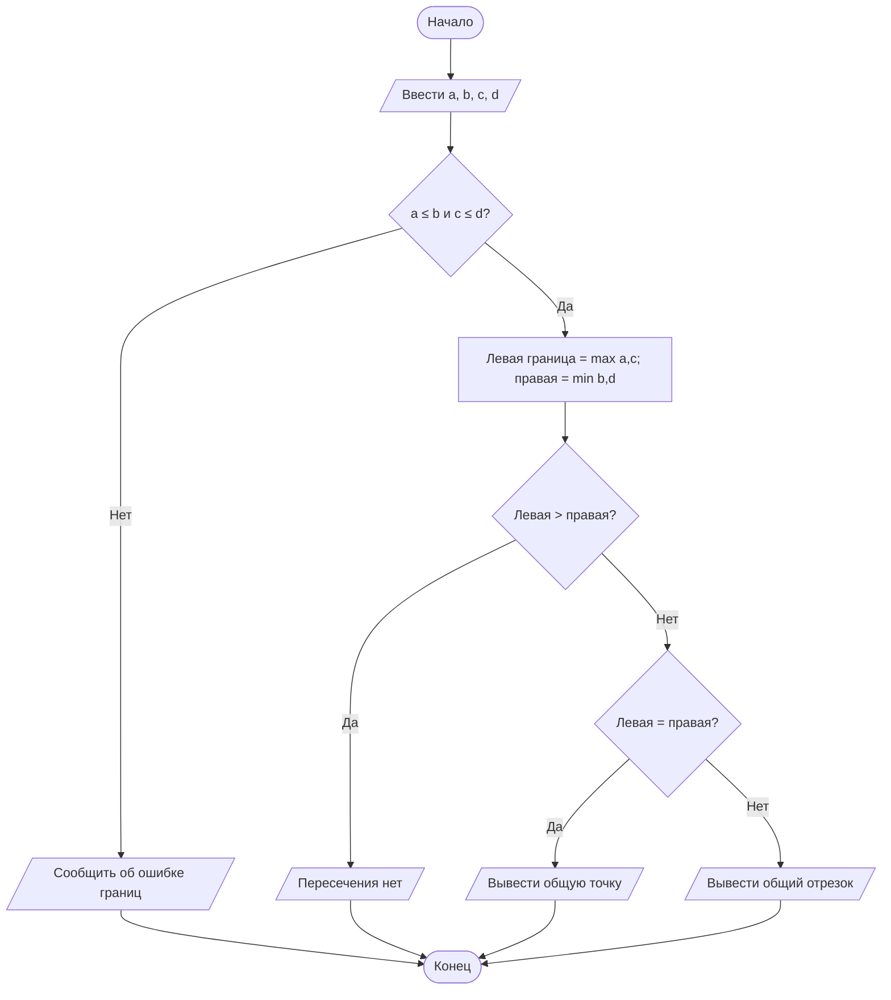

# Отчёт по заданию 2-3, вариант 25

Группа ИБД 621-2.

Для отрезков `[a, b]` и `[c, d]` необходимо `a ≤ b`, `c ≤ d`. Левая граница общей части равна `max(a, c)`, правая — `min(b, d)`.

- Левая граница больше правой: пересечения нет.
- Границы равны: одна общая точка.
- Левая граница меньше правой: общий отрезок.

Контрольные примеры: `[1,3] ∩ [3,5] = {3}`; `[1,5] ∩ [2,3] = [2,3]`; `[1,2] ∩ [3,4] = ∅`.

